# Simulator screenshots

From commit 912e85e on `sideload-build`, run [#41](https://github.com/MrMallon/Interval-Timer/actions/runs/39695804534).

- `a11y-editor`: `dynamicType | Dynamic Type font sizes are partially unsupported | id= | label=A cycle is one full set of rounds. Repeat it with a longer rest in between.
dynamicType | Dynamic Type font sizes are partially unsupported | id= | label=Cancel
dynamicType | Dynamic Type font sizes are partially unsupported | id=saveButton | label=Save
contrast | Contrast nearly passed | id= | label=Cancel
contrast | Contrast nearly passed | id=saveButton | label=Save
contrast | Contrast nearly passed | id= | label=Same work and rest every round.
contrast | Contrast nearly passed | id= | label=
contrast | Contrast failed | id= | label=
contrast | Contrast nearly passed | id= | label=A cycle is one full set of rounds. Repeat it with a longer rest in between.
contrast | Contrast nearly passed | id= | label=
contrast | Contrast nearly passed | id= | label=0:30
contrast | Contrast nearly passed | id= | label=0:15
contrast | Contrast nearly passed | id= | label=`
- `a11y-history`: `contrast | Contrast nearly passed | id= | label=THURSDAY, OCTOBER 22, 2026
contrast | Contrast nearly passed | id= | label=Workouts this week
contrast | Contrast nearly passed | id= | label=Time this week
contrast | Contrast nearly passed | id= | label=0:03 · 0/2 rounds · ended early
contrast | Contrast nearly passed | id= | label=12:05 AM`
- `a11y-library`: `dynamicType | Dynamic Type font sizes are partially unsupported | id= | label=Edit
contrast | Contrast nearly passed | id= | label=Edit
contrast | Contrast nearly passed | id= | label=2 × 0:04 / 0:03 · 0:16
contrast | Contrast nearly passed | id= | label=2 × 0:12 / 0:06 · 0:32
contrast | Contrast nearly passed | id= | label=8 × 0:20 / 0:10 · 4:00
contrast | Contrast nearly passed | id= | label=10 × 0:40 / 0:20 · 10:50
contrast | Contrast nearly passed | id= | label=12 × 3:00 / 1:00 · 47:10`
- `a11y-run`: `no issues`
- `a11y-settings`: `contrast | Contrast nearly passed | id= | label=
contrast | Contrast nearly passed | id= | label=
contrast | Contrast failed | id= | label=
contrast | Contrast nearly passed | id= | label=
contrast | Contrast failed | id= | label=
contrast | Contrast failed | id= | label=
contrast | Contrast failed | id= | label=`
- `a11y-stopwatch`: `no issues`
- `a11y-summary`: `no issues`
- `cue-log-background`: `starts=4 countdowns=7 bg=13 maxLate=0.90 audio=1 la=1 laCount=1 laEnd=11.2 laPhase=Work appRemain=11.2`
- `cue-log-foreground`: `starts=4 countdowns=10 bg=0 maxLate=1.52 audio=1 la=1 laCount=1 laEnd=-0.3 laPhase=Work appRemain=0.0`

### 01-library

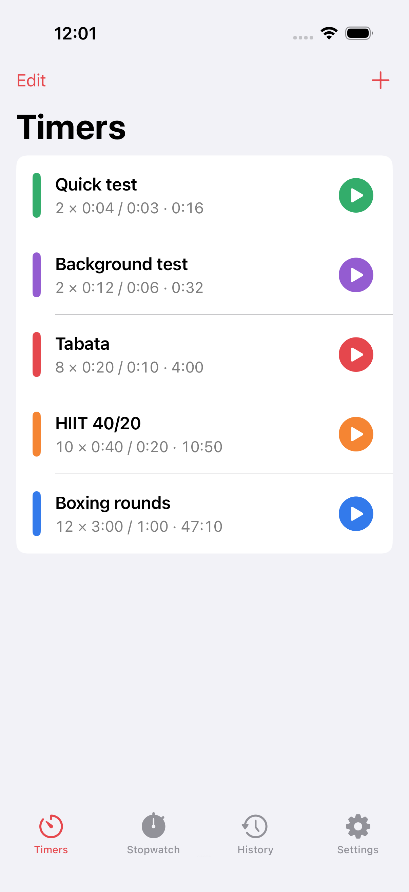

### 02-editor-simple

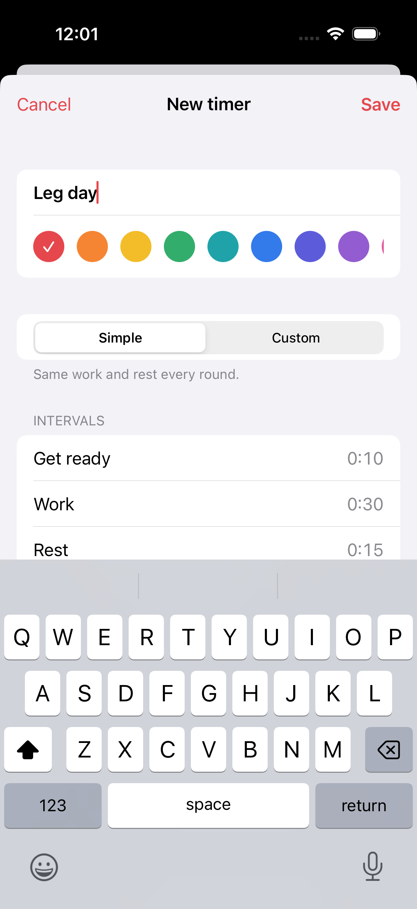

### 03-library-after-edit

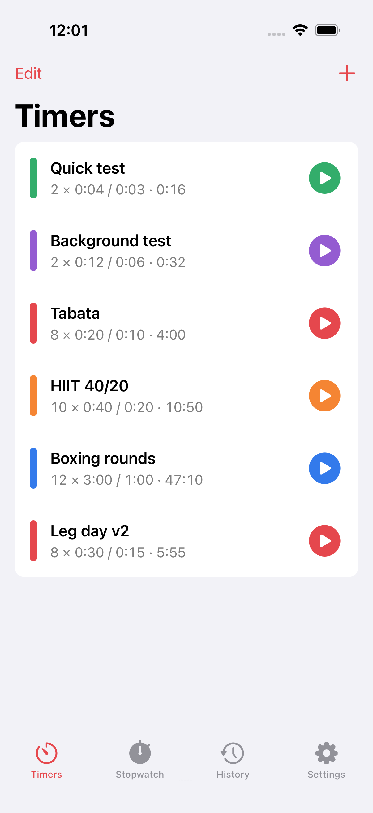

### 04-presets

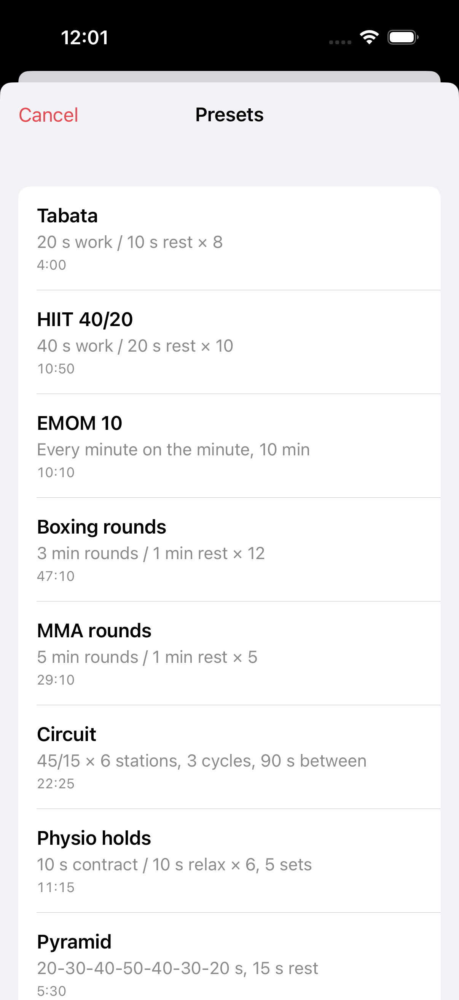

### 05-editor-custom-pyramid

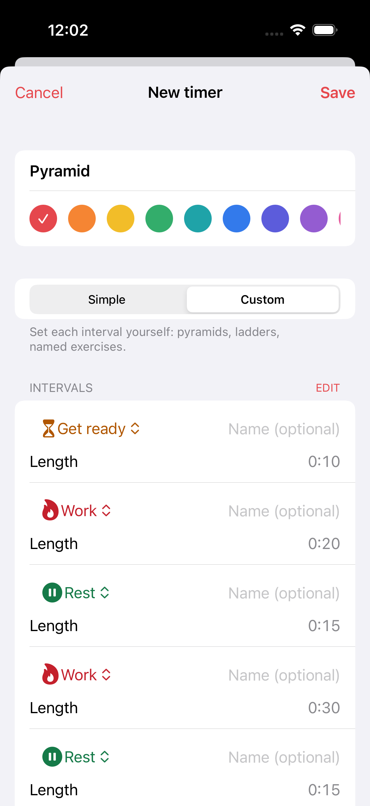

### 06-run-get-ready

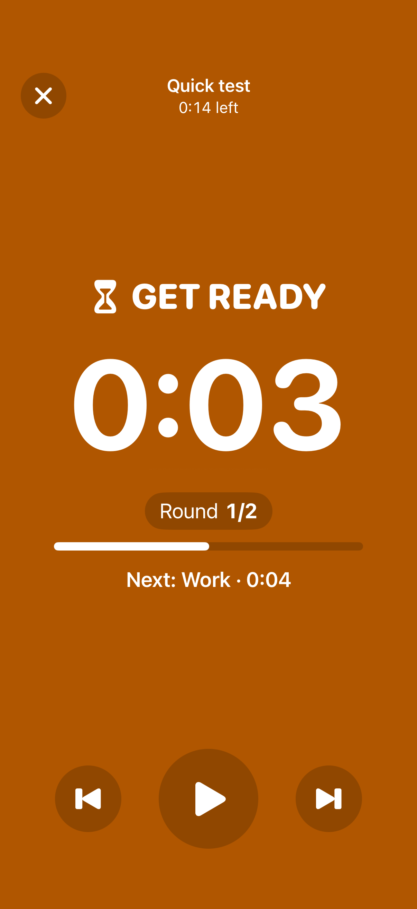

### 07-run-work

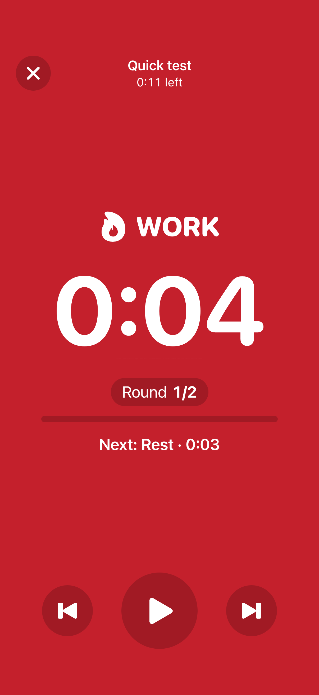

### 08-run-paused

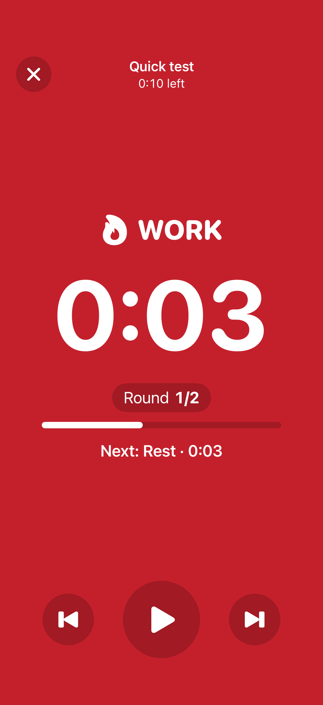

### 09-run-rest

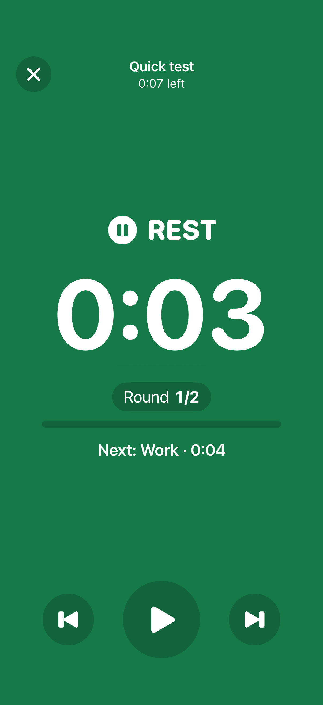

### 10-summary

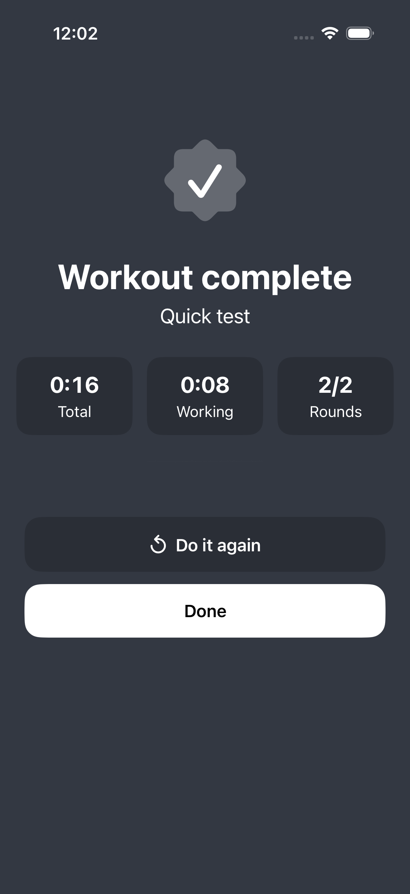

### 11-history

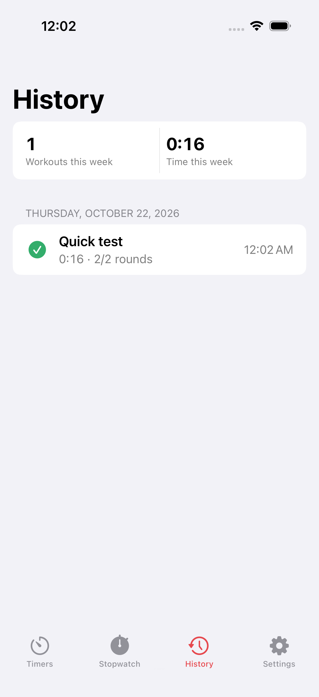

### 12-after-background

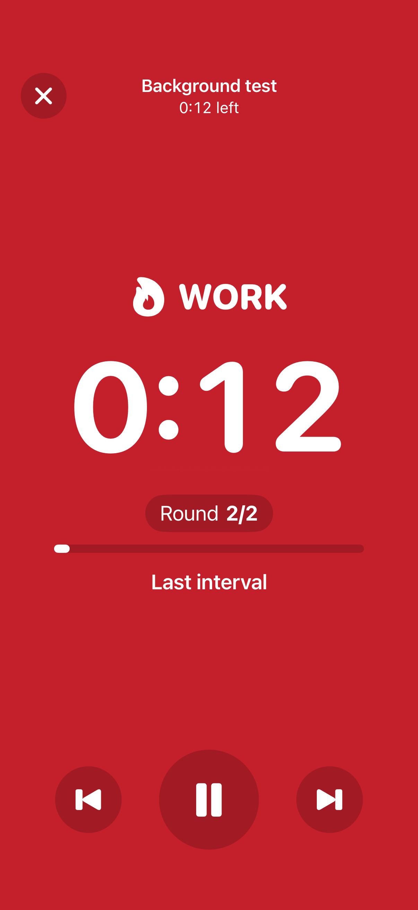

### 13-stopwatch

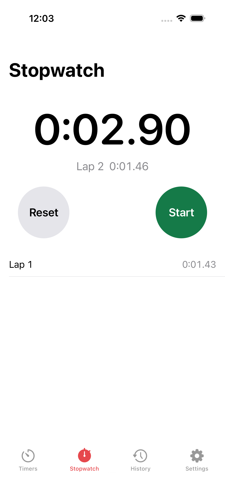

### 14-settings

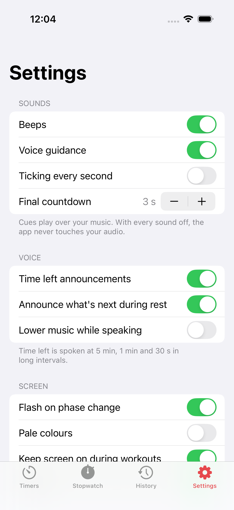

### 15-settings-bottom

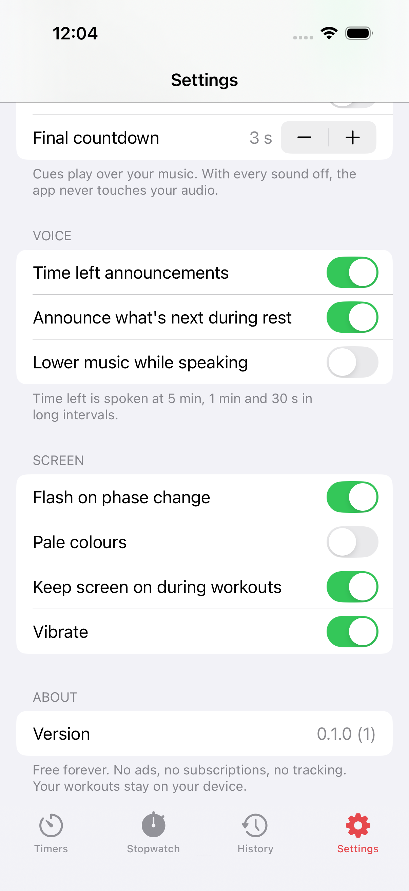

### 16-de-library

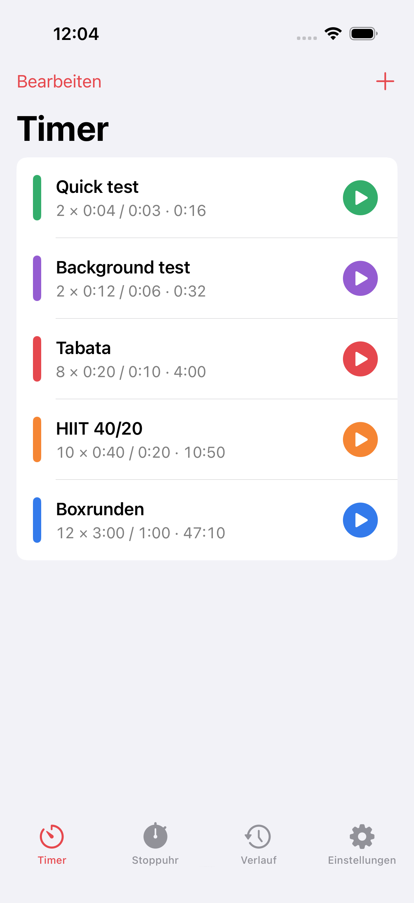

### 16-ja-library

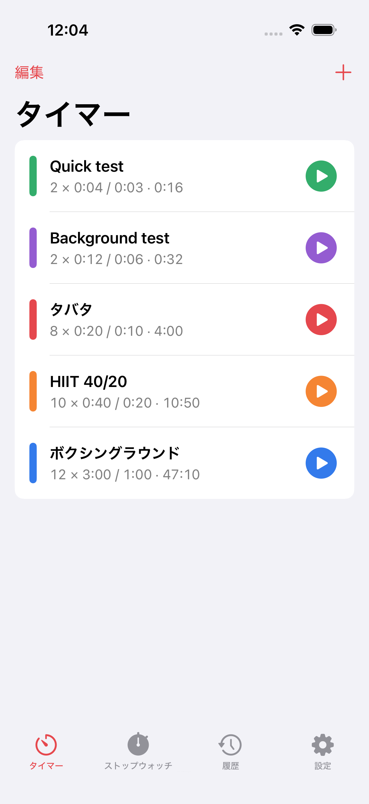

### 17-de-run

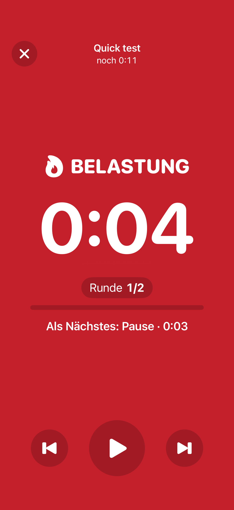

### 17-ja-run

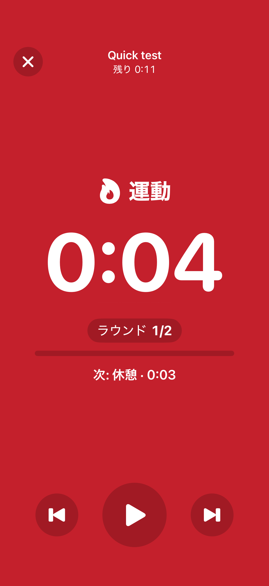

### 18-dynamic-island-paused

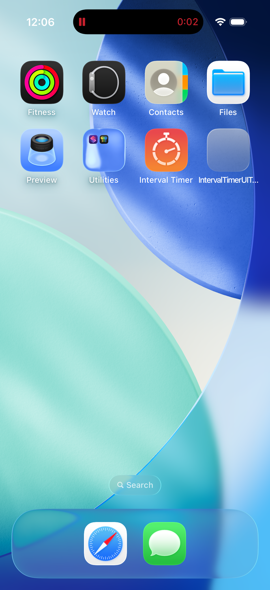

### 18-dynamic-island-running

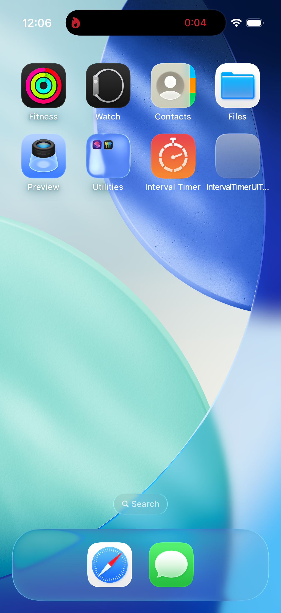

